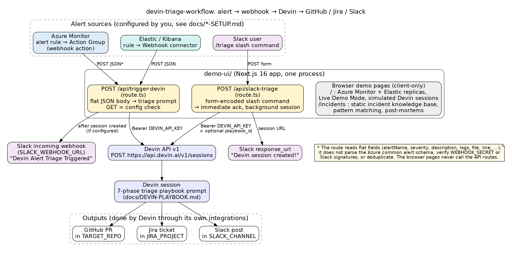

# Devin Triage Workflow

### Automatically triage, analyze, and fix production issues with Devin AI

When alerts fire from your monitoring system, Devin automatically analyzes the issue, identifies the root cause, implements a fix, creates a PR, and notifies your team — all in minutes, not hours.

---

## 🎯 What This Does

```
Alert Fires → Devin Analyzes → Root Cause Found → PR Created → Team Notified
     ↓              ↓                ↓                ↓              ↓
  30 seconds    2 minutes        5 minutes       8 minutes      Done ✅
```

**Instead of:**
- Engineer gets paged at 3 AM 😴
- Spends 30 min understanding the alert
- Spends 1 hour finding root cause
- Spends 2 hours writing a fix
- Creates PR next morning

**With Devin Triage:**
- Alert fires → Devin session auto-created
- Devin clones repo, traces error, identifies root cause
- Devin creates PR with fix + tests
- Engineer wakes up to a solved problem ☕

---

## 🛠️ Two Integration Paths

Choose your monitoring platform, or use both for defense-in-depth:

| | Azure Monitor | Elastic (Kibana) |
|---|---|---|
| **Best for** | Azure-native workloads | Complex log analysis, ML |
| **Setup time** | ~30 minutes | ~45 minutes |
| **Alert types** | Metrics, Logs, Activity | Logs, Metrics, ML Anomaly |
| **Query language** | KQL | KQL, Lucene, ES DSL |
| **Cost** | Often included with Azure | Subscription or self-managed |

### Path 1: Azure Monitor
Perfect if you're running on Azure (AKS, App Service, Functions, VMs).

**→ [Azure Monitor Setup Guide](./docs/AZURE-MONITOR-SETUP.md)**

### Path 2: Elastic / Kibana  
Perfect if you're using the ELK stack or need ML-powered anomaly detection.

**→ [Elastic Setup Guide](./docs/ELASTIC-SETUP.md)**

### Path 3: Both (Recommended for Enterprise)
Use Azure Monitor for quick metric alerts + Elastic for deep log analysis and ML.

**→ [Comparison & Multi-Platform Guide](./docs/COMPARISON.md)**

---

## ⚠️ Before You Start: Is This Right for Your Alerts?

**The golden rule:** Devin is a software engineer, not a cloud administrator.

### ✅ Trigger Devin When:
| Alert Type | Why It Works |
|------------|--------------|
| **Application exceptions** | Devin can fix bugs in YOUR code |
| **API integration failures** | Devin can fix YOUR error handling |
| **Token/auth handling errors** | Devin can add retry logic to YOUR code |
| **Database query bugs** | Devin can fix YOUR queries |
| **Parsing/validation errors** | Devin can improve YOUR validation |

### ❌ Don't Trigger Devin When:
| Alert Type | Why It Fails |
|------------|--------------|
| **Azure IAM/permissions** | Devin can't modify your AD configuration |
| **Infrastructure failures** | Devin can't restart VMs or resize disks |
| **External service outages** | Devin can't fix Stripe being down |
| **Certificate expiration** | Devin can't renew your SSL certs |
| **User input errors** | Not a bug — expected behavior |

**→ [Full Use Cases & Best Practices Guide](./docs/USE-CASES.md)** — Detailed examples, alert configuration tips, and anti-patterns to avoid.

---

## 🚀 Quick Start (15 minutes)

### Step 1: Get Your Devin API Key

You'll need a Devin API key to create sessions. Choose the right key type for your use case:

| Key Type | Prefix | Best For | Docs |
|----------|--------|----------|------|
| **Personal API Key** | `apk_user_*` | Testing, personal automation | [Create Key →](https://app.devin.ai/settings/api-keys) |
| **Service API Key** | `apk_*` | Team automation, CI/CD | [Create Key →](https://app.devin.ai/settings/api-keys) |
| **Service User (v3)** | `cog_*` | Enterprise with RBAC | [Create Service User →](https://app.devin.ai/settings/enterprise/service-users) |

**To create a Personal or Service API Key:**
1. Go to [app.devin.ai/settings/api-keys](https://app.devin.ai/settings/api-keys)
2. Click **"Generate New API Key"**
3. Copy the key immediately (it's only shown once!)

> 📚 **Full API Documentation:**
> - [Authentication & API Keys](https://docs.devin.ai/api-reference/authentication) — Key types, security, troubleshooting
> - [v1 API Usage Examples](https://docs.devin.ai/api-reference/v1/usage-examples) — Creating sessions, monitoring, file uploads
> - [v1 Create Session](https://docs.devin.ai/api-reference/v1/sessions/create-a-new-devin-session) — Session creation endpoint

### Step 2: Deploy the Webhook Endpoint

You need a publicly accessible endpoint that receives alerts and calls the Devin API.

**Reference implementation:** See [`demo-ui/src/app/api/trigger-devin/route.ts`](./demo-ui/src/app/api/trigger-devin/route.ts), a Next.js route handler (it runs as part of the `demo-ui` Next.js app; [DEPLOYMENT.md](./docs/DEPLOYMENT.md) shows an Azure Functions port). How it works is in [docs/ARCHITECTURE.md](./docs/ARCHITECTURE.md).

Configure it with these environment variables (template: [`demo-ui/.env.example`](./demo-ui/.env.example)):

| Variable | Description | Where to Get |
|----------|-------------|--------------|
| `DEVIN_API_KEY` | Your Devin API key | [app.devin.ai/settings/api-keys](https://app.devin.ai/settings/api-keys) |
| `TARGET_REPO` | Repo Devin will analyze (defaults to `COG-GTM/azure-devops-mcp` if unset) | Your GitHub repo URL |
| `JIRA_PROJECT`, `SLACK_CHANNEL` | Optional: named in the prompt so Devin files the ticket and posts the update there | Your Jira project key / Slack channel |
| `SLACK_WEBHOOK_URL` | Optional: the endpoint posts a "Devin Alert Triage Triggered" message here | [Slack incoming webhooks](https://api.slack.com/messaging/webhooks) |

> The endpoint reads a flat JSON body (`alertName`, `severity`, `description`, `logs`, `file`, `line`, ...). It does not unwrap the Azure Monitor common alert schema or check `WEBHOOK_SECRET`; see [Known gaps](./docs/ARCHITECTURE.md#known-gaps-in-the-reference-code).

### Step 3: Connect Your Monitoring Platform

**Azure Monitor:**
1. Create an Action Group with a Webhook action
2. Point it to your deployed endpoint URL
3. Enable "Common alert schema"
4. Create Alert Rules that use your Action Group

**→ [Full Azure Monitor Guide](./docs/AZURE-MONITOR-SETUP.md)**

**Elastic:**
1. Create a Webhook Connector in Kibana
2. Point it to your deployed endpoint URL
3. Create Alerting Rules that use your Connector

**→ [Full Elastic Guide](./docs/ELASTIC-SETUP.md)**

### Step 4: Test It

```bash
curl -X POST https://your-endpoint-url/api/trigger-devin \
  -H "Content-Type: application/json" \
  -d '{"alertName":"test","severity":1,"description":"Test alert","file":"src/app.ts","line":1}'
```

You should receive `{"success": true, "session_id": "...", "url": "https://app.devin.ai/sessions/..."}`. Errors also come back as HTTP 200 with `"success": false` and an `error` message. Keep the `file` field: without it the reference route fails with `Cannot read properties of undefined (reading 'split')`.

---

## 📊 Why Azure Monitor?

### Benefits

| Benefit | Description |
|---------|-------------|
| **Native Integration** | Built into Azure Portal, no extra infrastructure |
| **Zero Setup for Azure Resources** | AKS, App Service, Functions already emit metrics |
| **Action Groups** | Reusable notification targets (webhook, email, SMS, Teams) |
| **Alert Processing Rules** | Route alerts to different actions based on severity/resource |
| **Cost Effective** | Often included in existing Azure spend |

### When to Choose Azure Monitor

✅ Running workloads on Azure (AKS, App Service, VMs, Functions)  
✅ Want fastest time-to-value (30 min setup)  
✅ Simple threshold-based alerts (error count > 0, latency > 10s)  
✅ Team already familiar with Azure Portal  
✅ Budget-conscious (often included in Azure subscription)

### Azure Monitor Architecture

```
┌─────────────────────┐
│   Your Azure        │
│   Resources         │
│  (AKS, App Service) │
└──────────┬──────────┘
           │ Metrics & Logs
           ▼
┌─────────────────────┐
│   Azure Monitor     │
│   Alert Rules       │
│  (KQL queries)      │
└──────────┬──────────┘
           │ Alert fires
           ▼
┌─────────────────────┐
│   Action Group      │
│   (Webhook action)  │
└──────────┬──────────┘
           │ POST request
           ▼
┌─────────────────────┐
│   Your Webhook      │
│   /api/trigger-devin│
└──────────┬──────────┘
           │ Creates session
           ▼
┌─────────────────────┐
│      Devin AI       │
│   Analyzes & Fixes  │
└──────────┬──────────┘
           │
     ┌─────┴─────┐
     ▼           ▼
┌─────────┐ ┌─────────┐
│ GitHub  │ │  Slack  │
│   PR    │ │  Alert  │
└─────────┘ └─────────┘
```

---

## 📊 Why Elastic?

### Benefits

| Benefit | Description |
|---------|-------------|
| **ML Anomaly Detection** | Automatically detect unusual patterns without manual thresholds |
| **Full-Text Search** | Powerful log analysis with Lucene and ES Query DSL |
| **Cross-Service Correlation** | Trace issues across microservices automatically |
| **Long-Term Retention** | Configurable data retention for compliance |
| **Multi-Cloud** | Works with any cloud or on-prem |

### When to Choose Elastic

✅ Need ML-powered anomaly detection (no manual thresholds)  
✅ Complex log analysis and correlation across services  
✅ Already using ELK stack or Elastic Cloud  
✅ Multi-cloud or hybrid environment  
✅ Security/SIEM use cases  
✅ Need advanced query capabilities (Lucene, ES DSL)

### Elastic Architecture

```
┌─────────────────────┐
│   Your Services     │
│  (any cloud/on-prem)│
└──────────┬──────────┘
           │ Logs (Filebeat, Logstash)
           ▼
┌─────────────────────┐
│   Elasticsearch     │
│   (Index & Search)  │
└──────────┬──────────┘
           │
     ┌─────┴─────┐
     ▼           ▼
┌─────────┐ ┌─────────┐
│ Kibana  │ │   ML    │
│ Rules   │ │  Jobs   │
└────┬────┘ └────┬────┘
     │           │
     └─────┬─────┘
           │ Alert fires
           ▼
┌─────────────────────┐
│ Webhook Connector   │
└──────────┬──────────┘
           │ POST request
           ▼
┌─────────────────────┐
│   Your Webhook      │
│   /api/trigger-devin│
└──────────┬──────────┘
           │ Creates session
           ▼
┌─────────────────────┐
│      Devin AI       │
│   Analyzes & Fixes  │
└─────────────────────┘
```

---

## 🔄 Why Use Both?

For enterprise environments, combining both platforms provides defense-in-depth:

| Layer | Platform | Use Case |
|-------|----------|----------|
| **Quick Alerts** | Azure Monitor | CPU > 90%, Memory > 85%, Error count > 0 |
| **Deep Analysis** | Elastic | Log correlation, pattern detection, ML anomaly |
| **Compliance** | Elastic | Long-term log retention, audit trails |
| **Cost Optimization** | Azure Monitor | Use included alerting for Azure resources |

### Combined Architecture

```
┌─────────────────────────────────────────────────────────────────┐
│                        Your Application                         │
└───────────────────────────────┬─────────────────────────────────┘
                                │
              ┌─────────────────┴─────────────────┐
              │                                   │
              ▼                                   ▼
┌──────────────────────┐             ┌──────────────────────┐
│    Azure Monitor     │             │       Elastic        │
│                      │             │                      │
│  • Metric alerts     │             │  • Log correlation   │
│  • Quick thresholds  │             │  • ML anomaly        │
│  • Azure-native      │             │  • Full-text search  │
└──────────┬───────────┘             └───────────┬──────────┘
           │                                     │
           └─────────────────┬───────────────────┘
                             │
                             ▼
                  ┌─────────────────────┐
                  │   Webhook Endpoint  │
                  │ (add deduplication) │
                  └──────────┬──────────┘
                             │
                             ▼
                  ┌─────────────────────┐
                  │      Devin AI       │
                  └─────────────────────┘
```

### Deduplication

When using both, add deduplication to the webhook to avoid double-triggering. The reference route does not deduplicate; this is a sketch you would add (with a Redis client of your choice):

```typescript
// Alerts from both platforms go to same endpoint
// Dedupe by alert signature (name + resource + time window)
const alertKey = `${alertName}:${resource}:${Math.floor(Date.now() / 300000)}`;
if (await redis.exists(alertKey)) return; // Already processing
await redis.set(alertKey, 'processing', 'EX', 300);
```

---

## 🏗️ Architecture



The repository's code is one Next.js 16 app in [`demo-ui/`](./demo-ui/):

- **`POST /api/trigger-devin`** receives alerts as flat JSON, builds a 7-phase triage prompt and creates a session through the Devin v1 API (`POST https://api.devin.ai/v1/sessions`), then optionally posts to a Slack incoming webhook. `GET` on the same path reports whether a key is configured.
- **`POST /api/slack-triage`** handles a Slack `/triage <sev> <name> | <description>` slash command: it answers Slack at once and creates the Devin session in the background (with tags, a title and `DEVIN_PLAYBOOK_ID` if set).
- **`/` and `/incidents`** are browser-only demo pages with simulated data; they do not call the API routes or Devin.

Details, configuration defaults and known gaps: **[docs/ARCHITECTURE.md](./docs/ARCHITECTURE.md)**. The diagram source is [`docs/diagrams/architecture.dot`](./docs/diagrams/architecture.dot) (Graphviz); run [`docs/diagrams/render.sh`](./docs/diagrams/render.sh) to regenerate the [PNG](./docs/diagrams/architecture.png) and [SVG](./docs/diagrams/architecture.svg).

---

## 📖 Documentation

| Guide | Description |
|-------|-------------|
| [Architecture](./docs/ARCHITECTURE.md) | How the reference code works, with the diagram |
| [**Use Cases & Best Practices**](./docs/USE-CASES.md) | **Start here** — When to use, when not to, alert tuning |
| [Azure Monitor Setup](./docs/AZURE-MONITOR-SETUP.md) | Step-by-step Azure configuration with portal links |
| [Elastic Setup](./docs/ELASTIC-SETUP.md) | Kibana alerting, Watcher, and ML setup |
| [Comparison Guide](./docs/COMPARISON.md) | Detailed feature comparison and decision matrix |
| [Devin Playbook](./docs/DEVIN-PLAYBOOK.md) | The 7-phase triage methodology |
| [API Reference](./docs/API-REFERENCE.md) | Webhook endpoint documentation |
| [Deployment Guide](./docs/DEPLOYMENT.md) | Azure Functions deployment |

---

## 🧪 Demo UI

The included demo UI simulates both Azure Monitor and Elastic alert experiences. Its pages run entirely in the browser with canned data: they do not call the webhook routes or create real Devin sessions.

```bash
cd demo-ui
npm install
npm run dev    # http://localhost:3000
```

**Features:**
- Azure Monitor replica with Action Group, Alert Rule and Alert Processing Rule UI
- Elastic/Kibana-style alerting interface
- Demo triggers for nine scenarios (Sev 1–3); only Sev 1 alerts start a simulated Devin session
- **Live Demo Mode** (Azure view): auto-generates Sev 2/3 alerts every 10–15 s and a Sev 1 alert every 30 s, stopping after 5 minutes
- Expandable alert details with logs, stack traces and similar past incidents
- **Incident knowledge base** at `/incidents`: historical incidents with filters, pattern-matched similar incidents and generated post-mortems

---

## 🔧 The Devin Triage Playbook

When an alert fires, Devin follows this structured 7-phase approach:

### Phase 1: Alert Analysis
Parse alert details, understand symptoms, document initial assessment.

### Phase 2: Codebase Analysis  
Clone repo, locate bug in code, trace stack, identify root cause.

### Phase 3: Triage Decision
Choose path: **Code Fix** / **Config Issue** / **External Issue** / **Escalate**

### Phase 4: Implement Fix
Minimal code changes, proper error handling, tests included.

### Phase 5: Create Pull Request
Clear title, problem description, solution explanation, linked to alert.

### Phase 6: JIRA Ticket (Optional)
Full tracking ticket with alert context, PR link, session link.

### Phase 7: Slack Notification (Optional)
Team notified with status, links to PR, JIRA, and Devin session.

**→ [Full Playbook Documentation](./docs/DEVIN-PLAYBOOK.md)**

---

## 💰 ROI Calculator

| Metric | Without Devin | With Devin | Savings |
|--------|---------------|------------|---------|
| MTTR (Mean Time to Resolve) | 4 hours | 30 minutes | **87% faster** |
| Engineer time per incident | 4 hours | 15 minutes (review) | **3.75 hours** |
| Incidents per month | 20 | 20 | — |
| Monthly engineer hours saved | — | — | **75 hours** |
| At $150/hour loaded cost | — | — | **$11,250/month** |

---

## 🔒 Security

- **API keys stored server-side** — never exposed to clients
- **Webhook secrets** — add a bearer check for incoming requests ([how](./docs/API-REFERENCE.md#authentication)); the reference route does not verify `WEBHOOK_SECRET` yet
- **No sensitive data logged** — only alert metadata processed
- **Devin operates in your repos** — you control access

---

## 🤝 Support

- **Documentation:** [docs/](./docs/)
- **Issues:** [github.com/COG-GTM/devin-triage-workflow/issues](https://github.com/COG-GTM/devin-triage-workflow/issues)
- **Devin Support:** [devin.ai/support](https://devin.ai/support)

---

## 📄 License

MIT License — see [LICENSE](./LICENSE)

---

<p align="center">
  <strong>Built with 🔱 by the Cognition GTM Team</strong>
  <br>
  <a href="https://cognition.ai">cognition.ai</a> · <a href="https://devin.ai">devin.ai</a>
</p>
