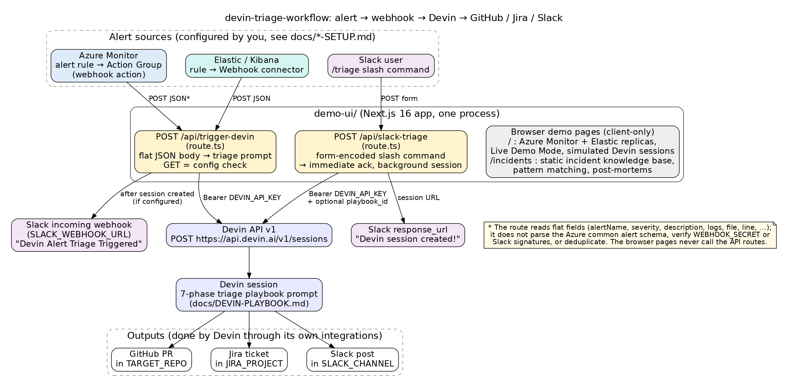

# Architecture

How the code in this repository works today (`main`). The setup guides in `docs/` describe how to configure Azure Monitor, Elastic and Devin around it; this page describes what the reference implementation in [`demo-ui/`](../demo-ui/) actually does.



The diagram source is [`diagrams/architecture.dot`](./diagrams/architecture.dot) (Graphviz). After editing it, run [`diagrams/render.sh`](./diagrams/render.sh) to regenerate [`architecture.png`](./diagrams/architecture.png) and [`architecture.svg`](./diagrams/architecture.svg).

## Components

`demo-ui/` is a single Next.js 16 (React 19, Tailwind 4) app. It holds two server routes, which are the webhook reference implementation, and two client-only demo pages. There is no database, queue or cache.

| Path | File | Kind | What it does |
|------|------|------|--------------|
| `POST /api/trigger-devin` | `src/app/api/trigger-devin/route.ts` | Server route | Alert webhook: builds the triage prompt and creates a Devin session |
| `GET /api/trigger-devin` | same file | Server route | Config check: `{configured, keyType, targetRepo, jiraProject, slackChannel}` (never returns the key) |
| `POST /api/slack-triage` | `src/app/api/slack-triage/route.ts` | Server route | Slack `/triage` slash command: acknowledges at once, creates the Devin session in the background |
| `/` | `src/app/page.tsx` | Client page | Azure Monitor and Elastic/Kibana replicas with alert triggers and Live Demo Mode |
| `/incidents` | `src/app/incidents/page.tsx` | Client page | Incident knowledge base: historical incidents, pattern matching, post-mortems |

## Alert webhook: `POST /api/trigger-devin`

1. Reads a **flat JSON body**: `alertName`, `severity`, `description`, `logs`, `affectedResource`, `resourceType`, `signalType`, `condition`, `threshold`, `actualValue`, `file`, `line`, `bugDescription`, `monitorUrl`, `firedTime`. It does not unwrap the Azure Monitor common alert schema (`data.essentials` / `data.alertContext`), so an Azure Action Group needs a payload mapped to these fields (for example a Logic App or a custom webhook body) before it reaches the route.
2. If `DEVIN_API_KEY` is unset, returns `{success: false, error: "DEVIN_API_KEY not configured", session_id: "demo_<ts>", url: ...}` without calling Devin.
3. Builds a 7-phase triage prompt (analyze, codebase analysis, triage decision, implement, Jira ticket, Slack post, wrap-up) that names `TARGET_REPO`, `JIRA_PROJECT` and `SLACK_CHANNEL`. The PR title it asks for is derived from `file`, so the request must include `file` (see [Known gaps](#known-gaps-in-the-reference-code)).
4. Calls `POST https://api.devin.ai/v1/sessions` with `Authorization: Bearer $DEVIN_API_KEY` and `{prompt, idempotent: false}`. This route does not send `playbook_id`, tags or a title.
5. If `SLACK_WEBHOOK_URL` is set, posts a "Devin Alert Triage Triggered" Block Kit message with a "View Devin Session" button.
6. Returns `{success: true, session_id, url}`.

Every response, including failures, is HTTP 200 with `success: false` and an `error` string (plus `message` holding the Devin API body when Devin rejects the call).

## Slack slash command: `POST /api/slack-triage`

1. Reads Slack's form-encoded fields (`text`, `user_id`, `user_name`, `channel_name`, `response_url`).
2. Parses `text` as `<severity 0-3> <alert name> | <description>`; severity defaults to 2 and the name to "Manual Triage Request".
3. Without `DEVIN_API_KEY`, answers with an ephemeral error. Otherwise it starts the session creation without awaiting it and immediately returns an in-channel "Triage Triggered via /triage" message.
4. The background call sends the prompt plus `tags` (`auto-triage`, `sev-N`, `slack-triggered`), a `title`, and `playbook_id` when `DEVIN_PLAYBOOK_ID` is set, then posts "Devin session created!" with the session link to `response_url`.

## Browser demo pages

Both pages run entirely in the browser with hard-coded data. They never call `/api/trigger-devin` or `/api/slack-triage` and never contact Devin; session IDs and URLs (`session_<timestamp>`) are generated client-side for the demo.

- **`/` (Azure Monitor / Elastic replicas).** A top bar switches between the two consoles. Nine canned alert scenarios (Sev 1: auth, timeout, null reference; Sev 2: memory, slow query, certificate expiry; Sev 3: deployment, shard rebalance, rate limit) can be fired by hand. Only Sev 1 alerts show a simulated Devin session (creating → analyzing → complete over about 8 s, with a notification banner). The alert detail panel has Summary, History, Diagnostics and Actions Taken tabs, including hard-coded "similar incidents" links to `/incidents`. The Azure view also has Action group, Alert rule and Alert processing rule configuration modals.
- **Live Demo Mode (Azure view).** A toggle that clears the alert list and generates alerts on timers: a first Sev 2 alert after 2 s, a Sev 2/3 alert every 10–15 s, a Sev 1 alert (with simulated Devin session) every 30 s, keeping at most 20 alerts and stopping on its own after 5 minutes.
- **`/incidents` (knowledge base).** Eight historical incidents with filters by search text, alert type and severity, summary stats, and a detail view with Overview, Post-Mortem and Similar (N) tabs. `findSimilarIncidents()` scores resolved incidents by alert type (0.4), alert-name word overlap (up to 0.2), same resource (0.2), log keyword tags (up to 0.1) and a resolved bonus (0.1), keeping matches at or above 0.3 (top 5).

## Configuration

Read from the server environment (`demo-ui/.env.example` is the template; copy it to `demo-ui/.env.local`).

| Variable | Used by | Default in code |
|----------|---------|-----------------|
| `DEVIN_API_KEY` | both routes | none; routes return a "not configured" response |
| `TARGET_REPO` | both routes (prompt text) | `https://github.com/COG-GTM/azure-devops-mcp` |
| `JIRA_PROJECT` | both routes (prompt text) | `PLATFORM` |
| `SLACK_CHANNEL` | both routes (prompt text) | `#alerts` (trigger-devin), `#devin-triage` (slack-triage) |
| `SLACK_WEBHOOK_URL` | trigger-devin | none; Slack notification skipped |
| `DEVIN_PLAYBOOK_ID` | slack-triage only | none; no `playbook_id` sent |
| `WEBHOOK_SECRET`, `SLACK_SIGNING_SECRET` | not checked by either route | — |

The browser pages show `COG-GTM/azure-devops-mcp` as the target regardless of `TARGET_REPO`.

## Known gaps in the reference code

These are behaviors of the code on `main`, recorded so the docs do not over-promise. The setup guides show how to add some of them.

- `POST /api/trigger-devin` without a `file` field fails with `Cannot read properties of undefined (reading 'split')` once `DEVIN_API_KEY` is set (it is computed for the PR title before the Devin call).
- No webhook authentication: `WEBHOOK_SECRET` and `SLACK_SIGNING_SECRET` are not verified. [API Reference → Authentication](./API-REFERENCE.md#authentication) shows how to add a bearer check.
- No deduplication across Azure and Elastic; the Redis snippets in the README and [COMPARISON.md](./COMPARISON.md) are examples to add.
- No Azure common alert schema parsing (see step 1 above).
- The Live Demo Mode sidebar says "P1 every 60 sec", but the timer fires a Sev 1 every 30 s (verified in the browser); this page documents the timer.
- `/api/slack-triage` creates the session after responding; on serverless hosts that freeze the function after the response, that background call may not finish.

## Running it

```bash
cd demo-ui
npm install        # or pnpm install (pnpm-lock.yaml is committed)
npm run build      # production build; there is no test script
npm run dev        # http://localhost:3000
```
